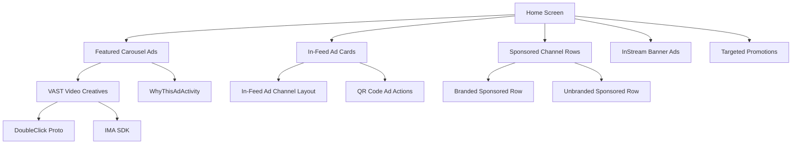

# 🔍 Google TV Launcher (com.google.android.tvlauncher) — Ad Reverse Engineering Report

> **APK:** `base.apk` v7.7.15 (build 968255986)
> **SHA256:** `883025035f403c1113f1f8cadf5c85a3363c1ddf0244ad31adb16a3880c3b4c5`
> **Package:** `com.google.android.tvlauncher`
> **Target SDK:** 37 (Android DEV)
> **Application Class:** `com.google.android.tvlauncher.application.TvLauncherApplication`

---

## 1. 🏷️ Launcher और Recommendation Service

| Component | Package Name | Role |
|---|---|---|
| **TV Launcher** | `com.google.android.tvlauncher` | Home screen, Featured Carousel, In-Feed Ads, Sponsored Channels |
| **TV Recommendations** | `com.google.android.tvrecommendations` | Sponsored channel data provider, Ad signals, Notification content |
| **LauncherX (Alternate)** | `com.google.android.apps.tv.launcherx` | Google TV alternate launcher (also queries `AdsSignalsContentProvider`) |

> [!IMPORTANT]
> यह APK **Google TV Launcher** (`com.google.android.tvlauncher`) है, **LauncherX** नहीं। Launcher, `com.google.android.tvrecommendations` से ads data fetch करता है।

### Manifest Evidence

```xml
<!-- AD_MANAGER_APP flag (Line 355) -->
<meta-data android:name="com.google.android.gms.ads.AD_MANAGER_APP" android:value="true"/>

<!-- Ad Services library (Line 335) -->
<uses-library android:name="android.ext.adservices" android:required="false"/>

<!-- AD_ID permission (Line 25) -->
<uses-permission android:name="com.google.android.gms.permission.AD_ID"/>

<!-- WhyThisAd Activity (Line 128) -->
<activity android:name="com.google.android.tvlauncher.home.featuredcarousel.WhyThisAdActivity"/>

<!-- Ads Personalization (Line 129) -->
<activity android:name="com.google.android.tvlauncher.home.AdsPersonalizationAwarenessDialogActivity"/>

<!-- Targeted Promotions (Line 135) -->
<activity android:name="com.google.android.tvlauncher.targetedpromotions.RedeemTargetedPromotionActivity"/>
```

---

## 2. 🎯 Ad System Architecture — Classes और Methods

### 🔴 Ad Types Found in Launcher



### 📂 Critical Ad Classes

| Class/Package | File | Purpose |
|---|---|---|
| `InStreamBannerView` | [InStreamBannerView.java](file:///e:/Github-Software/Andrpid-TV-Launcher/decompiled/sources/com/google/android/tvlauncher/home/instreambanner/InStreamBannerView.java) | **होम स्क्रीन पर बैनर ऐड्स** दिखाता है |
| `WhyThisAdActivity` | [WhyThisAdActivity.java](file:///e:/Github-Software/Andrpid-TV-Launcher/decompiled/sources/com/google/android/tvlauncher/home/featuredcarousel/WhyThisAdActivity.java) | "Why this ad?" dialog |
| `AdsPersonalizationAwarenessDialogActivity` | [AdsPersonalizationAwarenessDialogActivity.java](file:///e:/Github-Software/Andrpid-TV-Launcher/decompiled/sources/com/google/android/tvlauncher/home/AdsPersonalizationAwarenessDialogActivity.java) | Ad personalization notice |
| `AdsPersonalizationAwarenessNotificationReceiver` | [AdsPersonalizationAwarenessNotificationReceiver.java](file:///e:/Github-Software/Andrpid-TV-Launcher/decompiled/sources/com/google/android/tvlauncher/home/AdsPersonalizationAwarenessNotificationReceiver.java) | Ad notification dismiss |
| `RedeemTargetedPromotionActivity` | [RedeemTargetedPromotionActivity.java](file:///e:/Github-Software/Andrpid-TV-Launcher/decompiled/sources/com/google/android/tvlauncher/targetedpromotions/RedeemTargetedPromotionActivity.java) | Targeted promotional ads |
| `VideoCreative$VastXml$Builder` | [VastXml Builder](file:///e:/Github-Software/Andrpid-TV-Launcher/decompiled/sources/com/google/android/tvlauncher/doubleclick/proto/VideoCreative$VastXml$Builder.java) | **VAST video ad** creative builder (DoubleClick) |
| `VastParser` | [VastParser.java](file:///e:/Github-Software/Andrpid-TV-Launcher/decompiled/sources/com/google/android/tvlauncher/doubleclick/vast/VastParser.java) | VAST XML ad parser |
| `com.google.ads.interactivemedia.v3` | IMA SDK classes | **Google IMA SDK** for video ad insertion |
| `hpd.java` (AdsSignalsContentProvider) | [hpd.java](file:///e:/Github-Software/Andrpid-TV-Launcher/decompiled/sources/defpackage/hpd.java) | Ad signal provider URIs |
| `hzn.java` (Feature Flags) | [hzn.java](file:///e:/Github-Software/Andrpid-TV-Launcher/decompiled/sources/defpackage/hzn.java) | Feature flag controller for ads/sponsored content |
| `jmw.java` (Sponsored Badge) | [jmw.java](file:///e:/Github-Software/Andrpid-TV-Launcher/decompiled/sources/defpackage/jmw.java) | `sponsored_badge` TextView inflate |
| `jfn.java` (Channel Branding) | [jfn.java](file:///e:/Github-Software/Andrpid-TV-Launcher/decompiled/sources/defpackage/jfn.java) | `sponsored_channel_branding` text setup |
| `dk.java` (In-Feed Ad Adapter) | [dk.java](file:///e:/Github-Software/Andrpid-TV-Launcher/decompiled/sources/defpackage/dk.java) | In-feed ad channel layout inflation |
| `kbe.java` (In-Feed Ad View) | [kbe.java](file:///e:/Github-Software/Andrpid-TV-Launcher/decompiled/sources/defpackage/kbe.java) | In-feed ad card layout/margins |
| `khr.java` (Ad Card Inflater) | [khr.java](file:///e:/Github-Software/Andrpid-TV-Launcher/decompiled/sources/defpackage/khr.java) | `view_in_feed_ad_card` layout inflation |
| `ihd.java` (Sony Sponsored Row) | [ihd.java](file:///e:/Github-Software/Andrpid-TV-Launcher/decompiled/sources/defpackage/ihd.java) | `sony-sponsored-row-v1` special sponsored row |

### 📡 Ad Data Flow

```
AdsSignalsContentProvider (tvrecommendations)
    ↓
hpd.java → URI: content://com.google.android.tvrecommendations.ads.signals.AdsSignalsContentProvider
    ↓
hyt.java → Query ad signals → Build ad request
    ↓
ihx.java → POST to pagead2.googlesyndication.com/pagead/gen_204
    ↓
VideoCreative$VastXml → Parse VAST XML ad response
    ↓
InStreamBannerView / In-Feed Ad Card / Featured Carousel → Render ad on Home
```

---

## 3. 🌐 Ad Domains और URLs (Decompiled Evidence)

| Domain/URL | Found In | Purpose |
|---|---|---|
| `pagead2.googlesyndication.com/pagead/gen_204` | [ihx.java:872](file:///e:/Github-Software/Andrpid-TV-Launcher/decompiled/sources/defpackage/ihx.java) | **Ad ping/impression tracking** |
| `pagead2.googlesyndication.com/pagead/gen_204?id=gmob-apps` | [dwq.java:17](file:///e:/Github-Software/Andrpid-TV-Launcher/decompiled/sources/defpackage/dwq.java) | **Mobile app ad request** |
| `pagead2.googlesyndication.com/pagead/ping?e=2&f=1` | [dxh.java:701](file:///e:/Github-Software/Andrpid-TV-Launcher/decompiled/sources/defpackage/dxh.java) | **Remote capture/ad diagnostics** |
| `com.google.android.tvrecommendations.ads.signals.AdsSignalsContentProvider` | [hpd.java](file:///e:/Github-Software/Andrpid-TV-Launcher/decompiled/sources/defpackage/hpd.java) | **Local ad signal data** |
| `com.google.android.apps.tv.launcherx.ads.signals.AdsSignalsContentProvider` | [hpd.java:15](file:///e:/Github-Software/Andrpid-TV-Launcher/decompiled/sources/defpackage/hpd.java) | LauncherX ad signals |

### 🔒 Complete Domain Block List

```
# === PRIMARY AD DOMAINS (from decompiled code) ===
pagead2.googlesyndication.com
googleads.g.doubleclick.net
adservice.google.com
www.googleadservices.com
imasdk.googleapis.com
ad.doubleclick.net

# === SECONDARY AD/TRACKING DOMAINS ===
ade.googlesyndication.com
pagead2.googlesyndication.com
tpc.googlesyndication.com
www.googletagservices.com
www.googletagmanager.com
stats.g.doubleclick.net
cm.g.doubleclick.net
s0.2mdn.net
s1.2mdn.net

# === TV-SPECIFIC AD DOMAINS ===
fundingchoicesmessages.google.com
yt3.ggpht.com
tv.google.com/freeplay
```

---

## 4. 🛡️ ADB Commands — Ads Block करने के लिए

### Method 1: DNS-based Domain Blocking (Recommended — Safest)

Pi-hole, AdGuard Home, या NextDNS पर ये domains block करें:

```bash
# Pi-hole / AdGuard / hosts file entries:
0.0.0.0 pagead2.googlesyndication.com
0.0.0.0 googleads.g.doubleclick.net
0.0.0.0 adservice.google.com
0.0.0.0 www.googleadservices.com
0.0.0.0 imasdk.googleapis.com
0.0.0.0 ad.doubleclick.net
0.0.0.0 ade.googlesyndication.com
0.0.0.0 tpc.googlesyndication.com
0.0.0.0 www.googletagservices.com
0.0.0.0 stats.g.doubleclick.net
0.0.0.0 cm.g.doubleclick.net
0.0.0.0 s0.2mdn.net
0.0.0.0 s1.2mdn.net
0.0.0.0 fundingchoicesmessages.google.com
```

### Method 2: ADB Shell Commands (TV पर सीधे चलाएं)

```bash
# === STEP 1: TV से Connect करें ===
adb connect <TV_IP>:5555

# === STEP 2: TV Recommendations (Ads Provider) Disable करें ===
adb shell pm disable-user --user 0 com.google.android.tvrecommendations

# === STEP 3: Featured Carousel Ad Activities Disable करें ===
adb shell pm disable com.google.android.tvlauncher/com.google.android.tvlauncher.home.featuredcarousel.WhyThisAdActivity
adb shell pm disable com.google.android.tvlauncher/com.google.android.tvlauncher.home.AdsPersonalizationAwarenessDialogActivity
adb shell pm disable com.google.android.tvlauncher/com.google.android.tvlauncher.targetedpromotions.RedeemTargetedPromotionActivity

# === STEP 4: Ad Personalization Notification Receiver Disable ===
adb shell pm disable com.google.android.tvlauncher/com.google.android.tvlauncher.home.AdsPersonalizationAwarenessNotificationReceiver

# === STEP 5: Google Ad ID revoke करें ===
adb shell pm revoke com.google.android.tvlauncher com.google.android.gms.permission.AD_ID

# === STEP 6: Phenotype/GServices Ad Flags Override करें ===
# Featured Carousel Ads बंद
adb shell settings put global hidden_api_policy_p_apps 1
adb shell settings put global hidden_api_policy_pre_p_apps 1

# Content URI से sponsored channel data हटाएं
adb shell content delete --uri content://com.google.android.tvrecommendations.NotificationContentProvider/notifications

# === STEP 7: Ad network access block करें (iptables - root required) ===
# अगर root है:
adb shell su -c "iptables -A OUTPUT -d pagead2.googlesyndication.com -j DROP"
adb shell su -c "iptables -A OUTPUT -d googleads.g.doubleclick.net -j DROP"
adb shell su -c "iptables -A OUTPUT -d adservice.google.com -j DROP"
adb shell su -c "iptables -A OUTPUT -d imasdk.googleapis.com -j DROP"

# === STEP 8: Launcher restart करें ===
adb shell am force-stop com.google.android.tvlauncher
adb shell am start -n com.google.android.tvlauncher/.MainActivity

# === STEP 9: Sponsored channel data clear करें ===
adb shell pm clear com.google.android.tvrecommendations
```

### Method 3: Launcher Settings (ADB, No Root)

```bash
# Freeplay (Free ad-supported content) disable
adb shell settings put secure freeplay_enabled 0

# Ad personalization opt-out
adb shell settings put secure limit_ad_tracking 1

# Featured content / discover row disable via home screen settings
adb shell am start -n com.google.android.tvlauncher/.settings.HomeScreenSettingsActivity
# → Manually disable "Show recommendations on home" / "Customize channels"
```

---

## 5. 📊 Summary Evidence Table

| Finding | Evidence Type | Evidence ID / Location |
|---|---|---|
| APK = Google TV Launcher v7.7.15 | Manifest | [AndroidManifest.xml:1](file:///e:/Github-Software/Andrpid-TV-Launcher/apktool_decoded/AndroidManifest.xml#L1) |
| AD_MANAGER_APP = true | Manifest meta-data | [Line 355](file:///e:/Github-Software/Andrpid-TV-Launcher/apktool_decoded/AndroidManifest.xml#L355) |
| Google IMA SDK embedded | Decompiled classes | `com.google.ads.interactivemedia.v3.*` |
| DoubleClick VAST protocol | Decompiled proto | `com.google.android.tvlauncher.doubleclick.proto.*` |
| InStream Banner View | Decompiled UI | `home/instreambanner/InStreamBannerView.java` |
| In-Feed Ad Cards | Decompiled layouts | `R.layout.in_feed_ad_channel`, `R.layout.view_in_feed_ad_card` |
| Sponsored Channels | Decompiled data | `sponsored.legacy`, `sony-sponsored-row-v1` |
| pagead2 domain | Hardcoded URL | `dwq.java:17`, `ihx.java:872`, `dxh.java:701` |
| AdsSignalsContentProvider | Content URI | `hpd.java` (both tvrecommendations + launcherx) |
| Targeted Promotions | Activity | `RedeemTargetedPromotionActivity` |
| REA Archive Inspection | `ev_6e48144194b62edfa9bb5aac729a72390fe2d5967be3fd6bc344fb97580d8fc5` | 1243 files, 1277 occurrences |

> [!WARNING]
> **`com.google.android.tvrecommendations` disable करने से** कुछ legitimate recommendations (Watch Next, Continue Watching) भी बंद हो सकते हैं। DNS blocking सबसे safe approach है।

> [!CAUTION]
> ये findings **static analysis** पर based हैं। Runtime behavior dynamic feature flags (Phenotype) पर depend करता है जो Google server-side control करता है। `iptables` commands root access require करती हैं।
